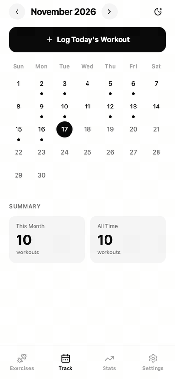
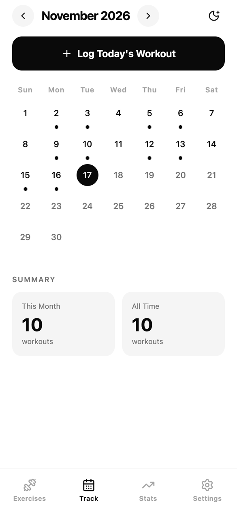
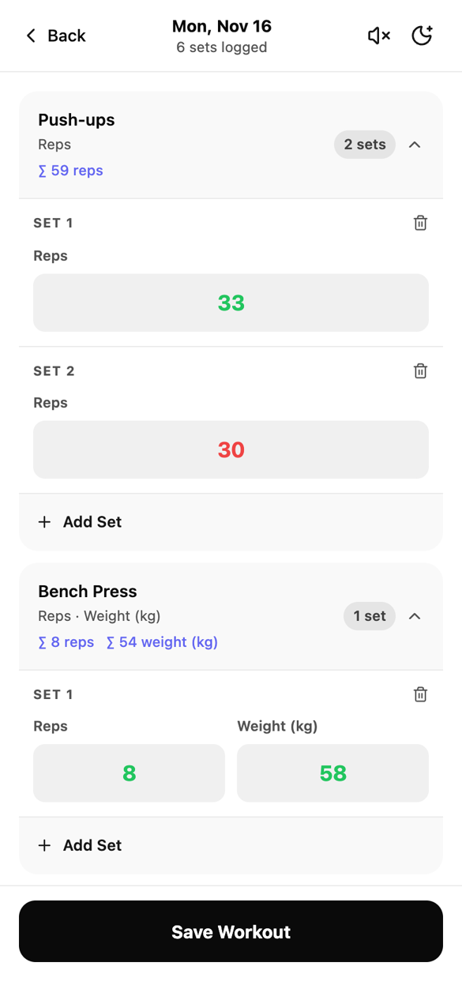
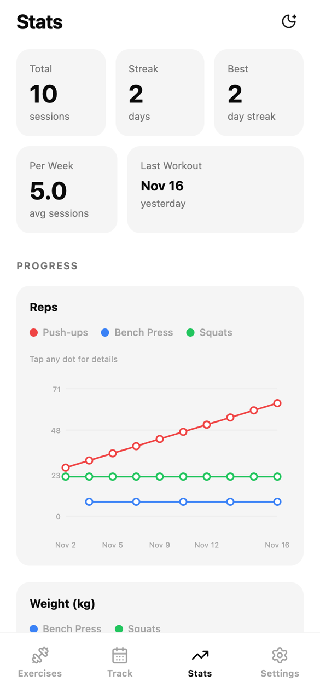
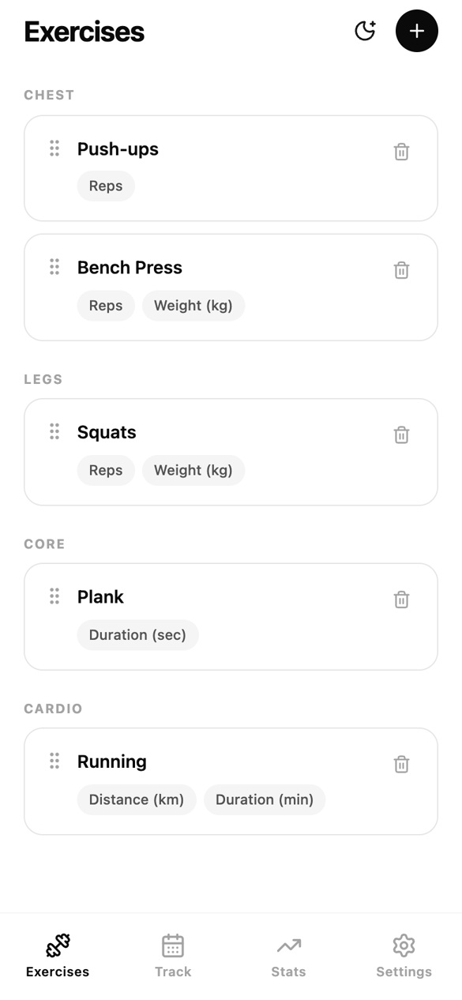
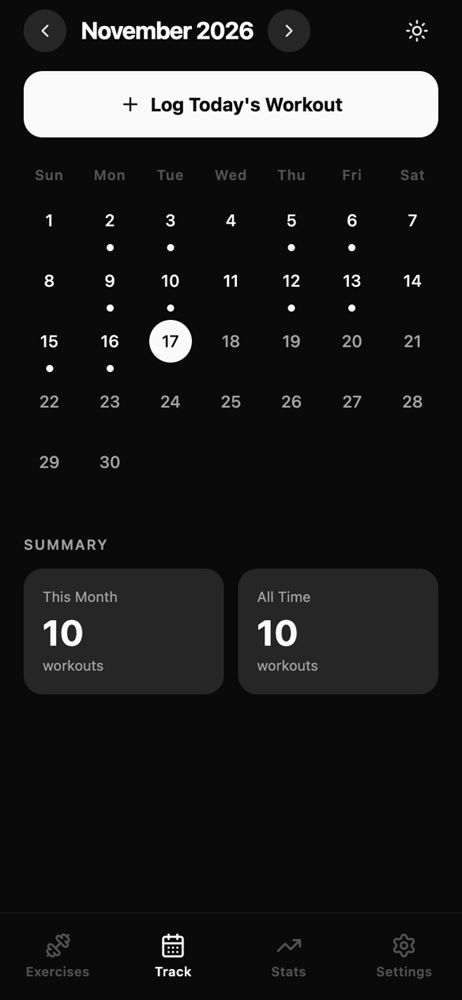
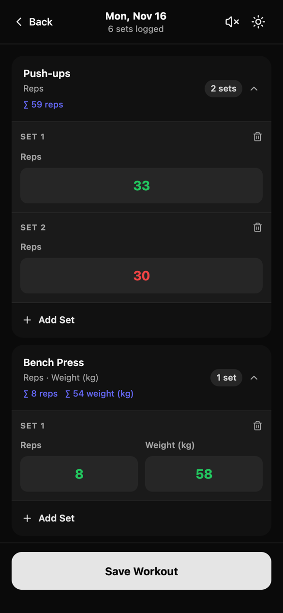
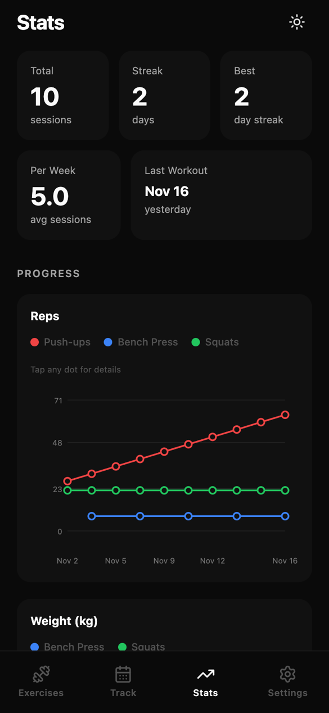
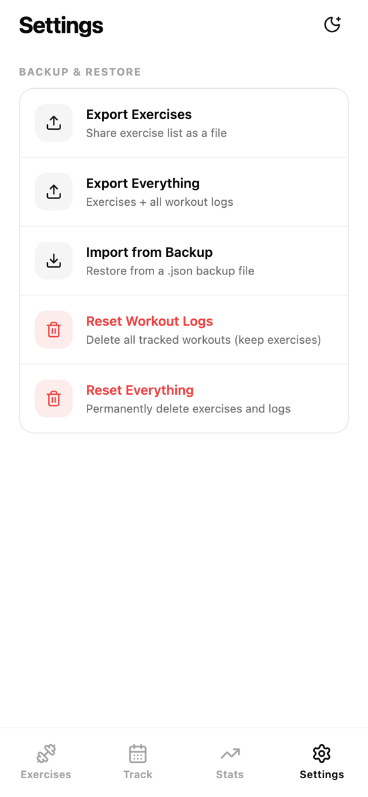

# My Workout Tracker

A free workout tracker with no paywall, no account and no internet needed. Add your own exercises, log your sets each day, see the days you trained on a calendar, and watch your numbers grow on a chart. Everything stays on your device.

**[Try it in your browser →](https://p32929.github.io/home_workout_react_native/)** &nbsp;·&nbsp; **[Download for Android →](https://github.com/p32929/p32929_openstore/releases/tag/my-workout-tracker)**

<p align="center">
  
</p>

## Why I made it

I made this app just for myself. I needed a simple workout tracker, but almost every one I found on the Google Play Store was paid or kept asking me to pay. So I made my own. I didn't build it with other people in mind, but if it helps you too, great.

## Screenshots

<p>
  
  
  
  
</p>
<p>
  
  
  
  
</p>

## Features

1. **Your own exercises:** track anything with your own units, like reps, kg, seconds or km. Group exercises by category and drag them into your order.
2. **Daily log:** one entry per day, with as many sets per exercise as you like.
3. **See if you're improving:** while you log, each number turns green when it matches or beats your last session and red when it's lower. Last session's totals sit under each exercise.
4. **Calendar:** a dot marks every day you trained. Tap any day to log it or edit it.
5. **Stats:** total sessions, your current and best streak, sessions per week, and a line chart for every unit.
6. **Workout helpers:** the screen stays on while you log, and an optional tick sound plays once a second to help you count, for example during a plank.
7. **Backup and restore:** save your exercises, or everything, to a file and load it back on any device.
8. **Light and dark mode.**
9. **Private:** no account, no ads, no tracking. Your data is saved only on your device.

## How to use

1. Open **Exercises** and tap **+** to add an exercise, for example "Push-ups" with the unit "Reps".
2. Go to **Track** and tap **Log Today's Workout**. Tap an exercise, type your numbers, and tap **Add Set** for more sets.
3. Tap **Save Workout**. The day gets a dot on the calendar.
4. Open **Stats** to see your streaks and charts.
5. In **Settings**, use **Export Everything** now and then to keep a backup.

In the browser version, your data is saved in that browser. Clearing the site's data deletes it, so export a backup first.

## Run it yourself

You need [Node.js](https://nodejs.org/) and [pnpm](https://pnpm.io/).

```bash
git clone https://github.com/p32929/home_workout_react_native.git
cd home_workout_react_native
pnpm install
pnpm dev            # then scan the QR code with Expo Go
```

To open it straight on one platform, use `pnpm android`, `pnpm ios` or `pnpm web`. The web version deploys to GitHub Pages by itself on every push to `master`.

It is made with React Native, Expo and Uniwind.

## Good to know

This app is still being built, and it fits how I train rather than trying to be a big product.

## Contributing

Contributions are very welcome, thank you! Before you start on a pull request, please open an issue and tell me what you would like to add or change. That way we can agree on it first, and your time is not spent on something that might not fit.

## Share

<a href="https://p32929.github.io/share/?repo=home_workout_react_native"><picture><source media="(prefers-color-scheme: dark)" srcset="https://p32929.github.io/readme/share-dark.svg"></picture></a>

## Support

<a href="https://p32929.github.io/support/"><picture><source media="(prefers-color-scheme: dark)" srcset="https://p32929.github.io/readme/support-dark.svg"></picture></a>
